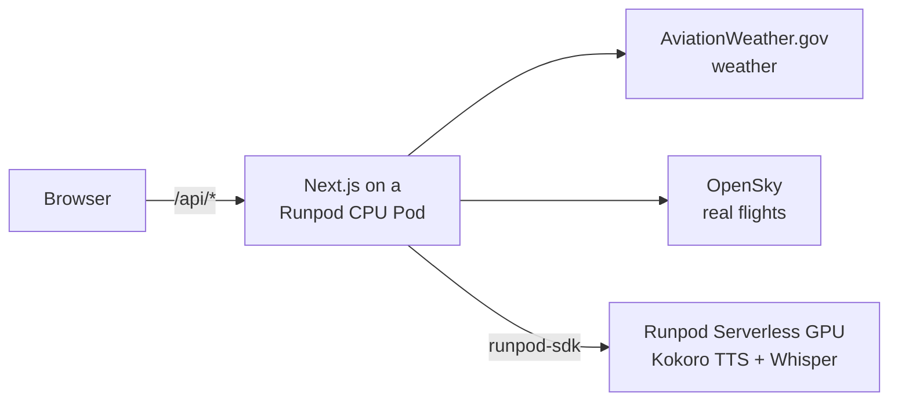

# Readback Trainer

Practice ATC readbacks with real-world data. Pick an airport and a call type, and the app plays a controller's call built from the airport's live weather and a real GA tail number that flew there yesterday. Read it back into your mic. The app transcribes what you said and grades each item: callsign, runway, altitude, heading, frequency, squawk.

It is also a Runpod sample for web developers. The Next.js app runs on a Runpod CPU Pod, and only the speech models run on a Runpod Serverless GPU.

> Training aid only. Not for real-world navigation or ATC communication.

## How it works



1. **New call.** The server fetches the METAR (local weather) and a real flight, then writes the controller's call and an answer key. The text shows right away.
2. **Listen.** The server sends the text to the GPU worker, which returns the controller's voice with a radio filter.
3. **Read back.** The browser records you. The GPU worker transcribes the recording with a Whisper model tuned for ATC.
4. **Grade.** The server compares your words to the answer key with plain rules, no AI. Wording can be loose; numbers must be exact.

The browser talks only to Next.js, and Next.js holds every key. The GPU scales to zero when nobody is practicing, so it costs nothing while idle. If the GPU is cold or down, you can type your readback instead and get the same grading.

All the Runpod code lives in two files, each written as numbered `RUNPOD STEP` blocks:

- [`web/lib/runpod.ts`](web/lib/runpod.ts): how the app calls the GPU.
- [`speech/main.py`](speech/main.py): the GPU worker itself.

## Before you start

You need:

- Node 22.12 or newer.
- Python 3.12, only to deploy the speech worker.
- A [Runpod](https://www.runpod.io) account with a few dollars of credit.
- A free [OpenSky Network](https://opensky-network.org) account. The app uses its API to fetch the real flights in each call. On your OpenSky Account page, create an API client and note its client ID and secret.
- A contact email for AviationWeather.gov, which serves the live weather. It needs no API key; you set the email in `web/.env.local` in the next step.

## 1. Run it locally (text only)

```
git clone https://github.com/<you>/readback-trainer-runpod.git
cd readback-trainer-runpod/web
npm ci
cp .env.example .env.local
```

Open `web/.env.local` and fill in:

| Variable | Value |
|---|---|
| `OPENSKY_CLIENT_ID`, `OPENSKY_CLIENT_SECRET` | Your OpenSky API client |
| `AWC_USER_AGENT` | Any name plus a contact, e.g. `readback-trainer (you@example.com)`. AviationWeather.gov requires one |
| `READBACK_DEMO_MODE` | `1` to enable the outage switches at `/?demo=1` (optional) |

Then start it:

```
npm run dev
```

Open http://localhost:3000, pick an airport and "Takeoff clearance", and press New call. Without the speech worker the page says "Voice unavailable", and you type your readback.

`npm test` runs the test suite offline in about a second.

## 2. Customize the app for your local area

You can practice with airports in your own area. This demo comes with three preconfigured airports:

- KTTD
- KVGT
- KORL

To add your favorite airports, edit `web/lib/airports.json`.

## 3. Deploy the speech worker (adds voice)

From the repo root:

```
cd speech
python3.12 -m venv .venv
.venv/bin/pip install -r requirements-dev.txt
export RUNPOD_API_KEY=<your Runpod API key>
.venv/bin/rp flash deploy
```

Your account API key is under **Settings** → **API Keys** in the Runpod console. The deploy takes a few minutes. Its last line prints `speech  <endpoint id>`; you can also find the ID in the Runpod console.

1. Put the endpoint ID in `web/.env.local` as `SPEECH_ENDPOINT_ID`.
2. In the console, create a Restricted API key that can only use that endpoint. Put it in `web/.env.local` as `RUNPOD_API_KEY`. The web app never needs your full account key.
3. Check the worker from `web/`:
   ```
   npx tsx --env-file=.env.local scripts/smoke.ts
   ```
   The first run takes about 30 s while a GPU starts. Then it prints the voice and transcription results.
4. Restart `npm run dev`. New calls now play audio, and you can hold the talk button to read back.

## 4. Put the app online on a Runpod Pod

Push your copy of the repo to GitHub, then in the Runpod console:

1. **Secrets:** create one secret per value in your `.env.local`: `readback_runpod_key` (the Restricted key), `readback_endpoint_id`, `readback_opensky_id`, `readback_opensky_secret` and `readback_awc_user_agent`.
2. **Pods → Deploy → CPU:** choose Compute-Optimized with 2 vCPU (about $0.06/hr) and a 10 GB container disk.
3. **Container image:** `node:22-bookworm-slim`. **Expose HTTP port:** `3000`.
4. **Environment variables:** map each secret to the name the app reads:
   ```
   RUNPOD_API_KEY={{ RUNPOD_SECRET_readback_runpod_key }}
   SPEECH_ENDPOINT_ID={{ RUNPOD_SECRET_readback_endpoint_id }}
   OPENSKY_CLIENT_ID={{ RUNPOD_SECRET_readback_opensky_id }}
   OPENSKY_CLIENT_SECRET={{ RUNPOD_SECRET_readback_opensky_secret }}
   AWC_USER_AGENT={{ RUNPOD_SECRET_readback_awc_user_agent }}
   READBACK_DEMO_MODE=1
   ```
5. **Container start command:** replace `<you>` with your GitHub user:
   ```
   bash -c "apt-get update && apt-get install -y --no-install-recommends git ca-certificates && git clone --depth 1 https://github.com/<you>/readback-trainer-runpod.git /app && cd /app/web && npm ci && npm run build && exec npm start -- -p 3000 -H 0.0.0.0"
   ```
6. Deploy. After about a minute, open `https://<POD_ID>-3000.proxy.runpod.net`.

Each restart clones the latest `main` and rebuilds, so restarting the Pod deploys your newest push.

## Deploy it with a coding agent

A coding agent such as Claude Code, Codex or Gemini CLI can run steps 1–4 for you. [`AGENTS.md`](AGENTS.md) gives it the deploy runbook, the Runpod gotchas and the code conventions.

1. Do the parts that need you: create the Runpod and OpenSky accounts, and fill `web/.env.local`.
2. Give the agent Runpod access. Export your API key as `RUNPOD_API_KEY` in the shell it runs in, or connect [Runpod's MCP server](https://docs.runpod.io/get-started/mcp-servers). In Claude Code:
   ```
   claude mcp add runpod --scope user -e RUNPOD_API_KEY=<your key> -- npx -y @runpod/mcp-server@latest
   ```
   Use a dedicated key, and delete it when the deploy is done.
3. Ask it, for example:
   ```
   Read AGENTS.md and deploy this app to my Runpod account. Ask me before each step that costs money.
   ```
4. When it asks, create the Restricted key for the speech endpoint in the console. The app runs with that key, not your account key.

Keep the agent's confirmation prompts on. It creates billed resources, and the Pod bills until you stop it.

## What it costs, and how to stop it

| Piece | Bills | Price |
|---|---|---|
| Speech worker (RTX 4090) | Only while a worker runs, plus 5 min after the last job | $1.10/hr, about $0.10 per practice session |
| CPU Pod | Every hour it runs | $0.06/hr, about $44/month if never stopped |

Stop the Pod when you're done. Its disk still costs about $0.03 a day until you terminate it. To remove everything:

1. Terminate the Pod.
2. `cd speech && .venv/bin/rp flash undeploy --app readback-speech --env default`
3. Delete the Restricted key in the Runpod console.

More detail is in [docs/costs.md](docs/costs.md).

## Try the outage handling

Set `READBACK_DEMO_MODE=1` and open `/?demo=1`. Two checkboxes simulate AviationWeather.gov or OpenSky going down. The call still builds from cached or made-up data, and the page says which. The full list of fallbacks, limits and timeouts is in [docs/architecture.md](docs/architecture.md).

## Known limits

- Airports: KTTD (Troutdale), KORL (Orlando Executive) and KVGT (North Las Vegas). Their frequencies and approaches in [`web/lib/airports.json`](web/lib/airports.json) come from public FAA data (October 2026). A pilot has not checked them yet.
- KTTD has only a circling approach, so its approach calls say "circle to runway 25". The intercept heading there is approximate.
- The grader doesn't yet handle split numbers like "squawk 45 21" or words like "runway thirteen left".
- Transcription has been tested with synthetic speech, not real pilot recordings.

## Further reading

- [AGENTS.md](AGENTS.md): context and rules for coding agents that deploy or change the app.
- [docs/architecture.md](docs/architecture.md): request flows, the two Runpod files step by step, fallbacks, timeouts.
- [docs/costs.md](docs/costs.md): pricing, cost per session, keeping the GPU warm.
- [docs/friction-log.md](docs/friction-log.md): what surprised us on Runpod while building this.
