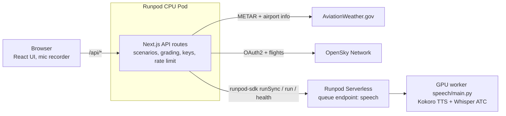

# Readback Trainer

A pilot picks a towered airport and a call type, hears a controller's transmission, reads it back into the mic, and gets a per-item scorecard. The weather is the airport's live METAR, and the callsign comes from a real GA flight that used the airport yesterday, when OpenSky has one.

It is also a Runpod sample for web developers. The app stays in Next.js (UI, API routes, keys, grading) on a Runpod CPU Pod. Only the GPU work, text-to-speech and speech-to-text, runs on a Runpod Serverless queue endpoint.

Training aid only. Not for real-world navigation or ATC communication.

## Where Runpod lives

Two files hold the whole integration. Each reads top to bottom as numbered `RUNPOD STEP` blocks.

[`web/lib/runpod.ts`](web/lib/runpod.ts) is the only app file that imports `runpod-sdk`:

1. Wait at most 80 s per job. The Pod proxy closes requests at 100 s, so the file races `runSync` against its own timer.
2. Connect to the speech endpoint with `RUNPOD_API_KEY` and `SPEECH_ENDPOINT_ID`, read only on the server.
3. Send a job with `runSync` and wait for it. A job still queued at 80 s becomes `SpeechWarming` (503). A failed job becomes `SpeechFailed` (502), carrying the worker's `error_message` without the traceback.
4. Expose the two jobs the app sends: `synthesize(text)` and `transcribe(audioWavB64)`.
5. `warmUp()` submits a `ping` job without waiting and returns `endpoint.health()` for the GPU status dot.

[`speech/main.py`](speech/main.py) is the GPU worker, deployed with `rp flash deploy`. It has no Dockerfile:

1. `runpod.App("readback-speech")`: one app per deploy.
2. `runpod.Model(...)` declares the Whisper weights, so Runpod stages them on the host before a worker starts.
3. `@app.queue(...)` describes the worker: 24 GB Ada GPU, 0–1 workers, 5 min idle timeout, 60 s per job, pinned dependencies.
4. The job's `input` dict arrives as keyword arguments: `speech(task, text, audio_wav_b64, radio_effect)`.

Every line that exists because of Runpod carries a `RUNPOD:` comment. This is the code part of `grep -rn "RUNPOD:" .` (the full command also lists this README and the planning docs):

```
$ grep -rn "RUNPOD:" web speech --exclude-dir=node_modules --exclude-dir=.venv --exclude-dir=.next
web/scripts/smoke.ts:4:import runpodSdk from "runpod-sdk"; // RUNPOD: the one allowed import outside lib/runpod.ts (DECISIONS.md)
web/scripts/smoke.ts:21:  if (!endpoint) throw new Error("runpod-sdk returned no endpoint"); // RUNPOD: endpoint() is typed Endpoint | null
web/scripts/smoke.ts:26:// RUNPOD: no Pod proxy here, so a 5 min timeout lets the first cold start finish
web/scripts/smoke.ts:29:  // RUNPOD: typed EndpointCompletedOutput, but FAILED adds `error` and a timeout returns no output
web/lib/runpod.ts:3:import "server-only"; // RUNPOD: a client import of this file fails the build, so the key can't leak
web/lib/runpod.ts:4:import runpodSdk from "runpod-sdk"; // RUNPOD: official JS client for Serverless endpoints
web/lib/runpod.ts:11:// RUNPOD: the Pod proxy (Cloudflare) closes requests at 100 s. runSync's own timeout restarts its
web/lib/runpod.ts:19:  // RUNPOD: read lazily so `next build` works without them; requireEnv names the missing var
web/lib/runpod.ts:21:  if (!endpoint) throw new Error("runpod-sdk returned no endpoint for SPEECH_ENDPOINT_ID"); // RUNPOD: typed Endpoint | null
web/lib/runpod.ts:25:// RUNPOD: a FAILED job's `error` is a JSON string holding error_type, error_message and
web/lib/runpod.ts:45:// RUNPOD: typed EndpointCompletedOutput, but the body is raw: FAILED adds `error`, a timeout has no `output`
web/lib/runpod.ts:54:    // RUNPOD: runSync posts /runsync, then polls /status-sync; it waits through a cold start
web/lib/runpod.ts:56:    if (res === "deadline") throw new SpeechWarming(); // RUNPOD: no answer within 80 s, worker still cold
web/lib/runpod.ts:58:    if (res.status === "IN_QUEUE" || res.status === "IN_PROGRESS") throw new SpeechWarming(); // RUNPOD: SDK gave up first
web/lib/runpod.ts:59:    throw new SpeechFailed(workerMessage(res.error)); // RUNPOD: FAILED (worker raised), CANCELLED or TIMED_OUT
web/lib/runpod.ts:75:// RUNPOD: /health also returns workers.unhealthy, which the SDK's HealthCheck type lacks
web/lib/runpod.ts:87:  await endpoint.run({ input: { task: "ping" } }); // RUNPOD: returns at once with a job id; the job wakes a worker
web/lib/runpod.ts:88:  return parseOutput(Health, await endpoint.health()); // RUNPOD: worker and job counts; `running` means a billed worker
speech/main.py:5:Every Runpod-specific line is tagged `# RUNPOD:`."""
speech/main.py:16:app = runpod.App("readback-speech")  # RUNPOD: app name used by deploy/undeploy
speech/main.py:19:WHISPER = runpod.Model("jacktol/whisper-large-v3-finetuned-for-ATC")  # RUNPOD: cold start skips the download
speech/main.py:25:# RUNPOD: deploy vendors requirements.txt with pip. Without --no-deps, kokoro and accelerate
speech/main.py:31:    gpu=runpod.GpuGroup.ADA_24,  # RUNPOD: 24 GB Ada pool (RTX 4090) avoids waiting on one SKU
speech/main.py:32:    workers=(0, 1),  # RUNPOD: zero workers when idle = zero GPU cost
speech/main.py:33:    idle_timeout=300,  # RUNPOD: stay warm 5 min across a practice session
speech/main.py:34:    execution_timeout_ms=60_000,  # RUNPOD: hard cap per job
speech/main.py:35:    model=WHISPER,  # RUNPOD: weights mounted read-only at WHISPER.path
speech/main.py:36:    dependencies=[  # RUNPOD: pinned, same as the top block of requirements.txt; torch comes with the image
speech/main.py:47:    models = _load_models(str(WHISPER.path))  # RUNPOD: where Runpod staged the Whisper weights
speech/main.py:54:    raise ValueError(f"unknown task: {task}")  # RUNPOD: surfaces as status FAILED in the JS client
```

`web/scripts/smoke.ts` is a CLI that calls the deployed worker directly. It is never bundled. The routes in `web/app/api/*` call only the functions that `lib/runpod.ts` exports.

## Setup

Requirements: Node 22 (≥ 22.12), Python 3.12, a Runpod account, an OpenSky account.

1. Install and test the web app:
   ```
   cd web
   npm ci
   npm test
   ```
2. Copy the env template, then fill it in (see [Environment](#environment)):
   ```
   cp .env.example .env.local
   ```
3. Start the dev server and open `http://localhost:3000`:
   ```
   npm run dev
   ```
4. Set up the speech venv and run its CPU tests:
   ```
   cd speech
   python3.12 -m venv .venv
   .venv/bin/pip install -r requirements-dev.txt
   .venv/bin/pytest -q
   ```

The web tests never touch the network or a GPU. Without the speech env vars the page still works in text-only mode.

## Environment

All variables live on the Next.js server (`web/.env.local` locally, Pod env vars in production). The worker needs none.

| Variable | Read by | Purpose |
|---|---|---|
| `RUNPOD_API_KEY` | `lib/runpod.ts` | Restricted key scoped to the speech endpoint |
| `SPEECH_ENDPOINT_ID` | `lib/runpod.ts` | Printed on the last line of `rp flash deploy` |
| `OPENSKY_CLIENT_ID`, `OPENSKY_CLIENT_SECRET` | `lib/sources/opensky.ts` | OAuth2 client credentials |
| `AWC_USER_AGENT` | `lib/sources/aviationweather.ts` | Identifies the app to AviationWeather.gov |
| `READBACK_DEMO_MODE` | `/api/scenario` | `1` enables the outage simulator at `?demo=1` |
| `RATE_LIMIT_PER_MIN` | `lib/rateLimit.ts` | Per-IP limit across all routes, default 30 |

Every file that reads a secret starts with `import "server-only"`, so a client import fails the build. No secret uses the `NEXT_PUBLIC_` prefix: Next.js inlines those values into the browser bundle. A missing variable throws `<NAME> is not set; see web/.env.example`.

## Deploy

### Speech worker (Serverless)

1. Install the venv from [Setup](#setup) step 4. `requirements-dev.txt` provides `rp` and also `numpy` and `scipy`. `rp` imports `main.py` to find the app, and `main.py` imports `numpy` and `scipy` at the top, so the deploy fails without them.
2. Export your API key. `rp` reads `RUNPOD_API_KEY` from the environment, so you do not need `rp login`:
   ```
   export RUNPOD_API_KEY=<your key>
   ```
3. Deploy from `speech/`:
   ```
   cd speech
   .venv/bin/rp flash deploy
   ```
4. Copy the endpoint ID from the last line of the output (`speech  <id>`) into `SPEECH_ENDPOINT_ID`.
5. In the Runpod console, open API Keys and create a Restricted key with access to that endpoint only. Use it as `RUNPOD_API_KEY` for the web app.

Two things about the build:

- torch comes from the worker image `runpod/queue-gpu:py3.12-latest` (`torch==2.9.1+cu128`). It is not in the dependency list.
- `main.py` sets `PIP_NO_DEPS=1` and `requirements.txt` pins the full dependency closure. Without this, kokoro and accelerate pull a second, CPU-only torch into the artifact, and it shadows the image's CUDA build. See [docs/friction-log.md](docs/friction-log.md).

To check the worker, run `npx tsx scripts/smoke.ts` from `web/`. It runs ping, tts and transcribe twice and prints cold and warm timings. It needs `web/scripts/fixtures/readback.wav`, which is not committed yet.

### Web app (CPU Pod)

(Not yet verified. T17 runs these steps on a real Pod.)

1. Create Runpod secrets for `RUNPOD_API_KEY` (the Restricted key), `SPEECH_ENDPOINT_ID`, `OPENSKY_CLIENT_ID`, `OPENSKY_CLIENT_SECRET` and `AWC_USER_AGENT`.
2. Create a CPU Pod from `node:22-bookworm-slim` and expose HTTP port 3000.
3. Map each secret to its plain name in the Pod's env config, for example `RUNPOD_API_KEY={{ RUNPOD_SECRET_speech_key }}`. The code reads only the plain names.
4. Set the start command. The slim image has no git, so install it first:
   ```
   bash -c "apt-get update && apt-get install -y --no-install-recommends git ca-certificates && git clone <repo-url> /app && cd /app/web && npm ci && npm run build && npm start -- -p 3000 -H 0.0.0.0"
   ```
5. Open `https://<POD_ID>-3000.proxy.runpod.net`.
6. Stop the Pod after the demo. A Pod bills every hour until you stop it.

Teardown: `rp flash undeploy --app readback-speech --env default`, terminate the Pod, revoke the Restricted key.

## Architecture



The browser talks only to Next.js. The Next.js server holds every key and is the only caller of AWC, OpenSky and Runpod. The Pod is always on; a GPU worker exists only while someone practices.

- Flow A, new call: `POST /api/scenario` fetches weather, airport info and a GA flight in parallel, then builds the scenario.
- Flow B, hear it: `POST /api/speak` → `synthesize()` → a radio-filtered WAV. The text card shows before the audio arrives.
- Flow C, read back: the browser records a 16 kHz mono WAV → `POST /api/attempt` → `transcribe()`, then grading on the CPU. When voice is unavailable, the user types and the UI calls `POST /api/grade`.
- Flow D, warm-up: page load → `POST /api/warmup` submits a `ping` job and returns health for the status dot.

Details, timeouts and caches: [docs/architecture.md](docs/architecture.md).

## Free-tier limits

- AviationWeather.gov: no key, at most 100 requests per minute, `User-Agent` required. The app caches METARs for 5 min (usable for 3 h after an outage) and airport info for 24 h.
- OpenSky Network: 4,000 credits per day for a registered account. Recording the test fixtures, 6 flight calls cost 180 credits. The app caches each airport's departure and arrival lists for 6 h, and the OAuth token until 60 s before it expires.
- Runpod bills by use. The worker scales to zero, so you pay for GPU seconds while a worker runs, including the 5 min idle timeout after the last job. The Pod bills by the hour until you stop it.

## Rate limits and outages

Requests from the browser are limited per IP (`cf-connecting-ip`, else `x-forwarded-for`): 30 per minute across all routes, and 6 per minute each on `/api/speak` and `/api/attempt`, the two GPU routes. Over the limit the route returns 429 and the page shows a banner.

An upstream failure never stops a scenario. Each source falls back to a labeled substitute, and the page says what was made up:

| Failure | What the app does | Banner |
|---|---|---|
| AWC 429, 5xx or timeout | Retry twice, then cached weather, then standard weather (calm, 29.92) | "Live weather unavailable — using weather from 42 min ago" |
| OpenSky down or out of credits | Cached flights, else a seeded made-up callsign | "Flight data unavailable — using a made-up callsign" |
| No GA flights yesterday | Made-up callsign | "No GA flights found yesterday — made-up callsign" |
| GPU cold, job still queued at 80 s | 503 `speech_warming`; the UI retries twice, 3 s apart, while the queued job wakes the worker | "Warming up the GPU (first call can take a minute)" |
| Worker job failed or unreachable | 502 `speech_failed`; text-only mode | "Voice unavailable — type your readback" |
| Microphone blocked | Text-only mode | "Microphone blocked — type your readback" |

To see the fallbacks, set `READBACK_DEMO_MODE=1` and open `/?demo=1`. Two checkboxes make AWC or OpenSky fail as if they returned 503.

## Why a GPU

The worker runs two models: Kokoro-82M for the controller's voice and `jacktol/whisper-large-v3-finetuned-for-ATC` for the readback. Whisper large-v3 is the heavy one, about 1.5 billion parameters, and the worker runs it in fp16 on CUDA. Serverless lets the GPU scale to zero between sessions, which an always-on GPU Pod cannot do.

Measured so far, with a ping-only worker on an RTX 4090 (T02):

| Case | Time |
|---|---|
| First job after deploy | 28.9 s |
| Cold start after scale-to-zero (FlashBoot) | 15.2 s |
| Warm | 0.4 s |

Timings with both models loaded, for ping, tts and transcribe, are pending the full smoke run.

## Current limits

- `web/lib/airports.json` is mostly `TODO`. Until a pilot fills frequencies, approaches, altitudes and nearby airports, only the `takeoff` call type builds. The others return 422 and name the missing fields.
- The aviation wording (phonetic spellings, gust phrasing, altitudes above 10,000, facility names) has open questions for the pilot. They are listed in `handoff/T04.md` and `handoff/T09.md`.
- The grader does not yet handle split digit runs ("squawk 45 21") or teen and tens words ("runway thirteen left"). See card P1 in `PLAN.md`.
- The full GPU smoke run and the Pod deploy are not done yet.

## AI use

Claude Code agents wrote this code, one task per session, from a build kit: `SPEC.md` (what to build), `PLAN.md` (task cards, each with an acceptance command), `AGENTS.md` (rules for every session) and `DECISIONS.md` (where the build differs from the spec, and why). Each agent left a handoff in `handoff/` for the next one. Runpod surprises went to `docs/friction-log.md`.

A pilot reviews the aviation wording and fills `airports.json` from the FAA Chart Supplement and approach plates. The agents leave `TODO` rather than guess a frequency, an approach or an altitude.
