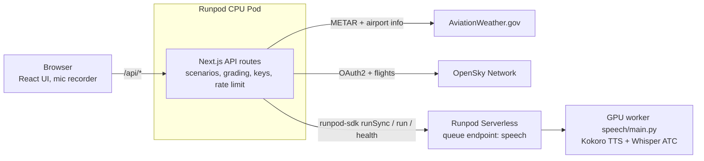

# Architecture



| Component | Runs on | Does | Talks to |
|---|---|---|---|
| UI (`web/app/page.tsx`, `web/app/components/`) | Browser | Pick airport and call type, play audio, record the mic, show the scorecard | `/api/*` only |
| API routes (`web/app/api/*`) | Runpod CPU Pod, `next start` | Build scenarios, grade, rate-limit, hold keys | AWC, OpenSky, speech worker |
| Speech worker (`speech/main.py`) | Runpod Serverless GPU, queue endpoint | `tts`, `transcribe`, `ping` | Nothing external |

The browser can't call the Serverless endpoint directly, because every request needs a bearer key. The Pod serves a public HTTPS URL and keeps the key on the server.

A queue endpoint holds a job while a worker cold-starts. A load-balancing endpoint would return errors until a worker is ready, and every client would need its own retry loop.

## Flow A: new call

1. The browser sends `POST /api/scenario {airport, type}`.
2. The route fetches three things in parallel: the METAR and airport info from AWC, and a GA flight from OpenSky for the previous UTC day. Approach calls use an arrival; the other call types use a departure.
3. Each source returns its data with a provenance (`live`, `cached`, `opensky` or `synthetic`) and any warnings.
4. `buildScenario()` picks the runway from the wind and fills the call type's template. It returns the controller text, the words for TTS and the answer key (`expected`). The same seed and data always give the same scenario.
5. The UI shows the call card at once, with the text hidden by default, and the warnings as banners.

A call type whose `airports.json` fields are `TODO` returns 422 and names the missing fields. No shipped field is `TODO` today. Circling-only approaches, such as KTTD's RNAV (GPS)-A, sit under the `circling` key of `approaches`; a straight-in approach to the runway in use wins over them.

## Flow B: hear it

1. The UI sends `POST /api/speak {text}` in parallel with showing the card. The text never waits for the GPU.
2. The route calls `synthesize()` in `lib/runpod.ts`, which runs a `tts` job with `runSync`.
3. The worker renders the text with Kokoro, applies a radio filter (300–3,000 Hz band, hiss, soft clipping) and returns a 24 kHz WAV as base64.
4. If the job is still queued at 80 s, the route returns 503 `speech_warming`. The UI retries twice, 3 s apart, and then switches to text-only. The queued job keeps waking the worker meanwhile.

## Flow C: read back

1. The user holds the talk button (or Space while it has focus). The browser records with `MediaRecorder` and converts the audio to a 16 kHz mono 16-bit WAV, at most 30 s.
2. The UI sends `POST /api/attempt {scenario, audio_wav_b64}`.
3. The route checks the WAV header on the Pod first (16 kHz, mono, 16-bit, 0.5–30 s), so a bad file never reaches the GPU.
4. `transcribe()` runs a `transcribe` job. Whisper, fine-tuned on ATC speech, returns the transcript.
5. `grade()` runs on the CPU. It normalizes the transcript and matches each expected item (callsign, altitude, heading, frequency, squawk, runway, ...) as correct, incorrect or missing.
6. The response holds the transcript and the grade.

When voice is unavailable (mic blocked, worker failed, warm-up retries used up), the user types the readback and the UI calls `POST /api/grade {scenario, transcript}`. Grading is the same.

## Flow D: warm-up

1. On page load the UI sends `POST /api/warmup`.
2. `warmUp()` submits a `ping` job with `run` (no waiting) and returns `endpoint.health()`.
3. The `ping` job loads both models, so the first real `tts` job finds a warm worker.
4. The UI polls every 10 s and colors the GPU status dot. Polling stops once a worker is ready (`ready`, `idle` or `running` > 0) or the endpoint is offline. Only `running` means a billed worker.

## The two Runpod files

[`web/lib/runpod.ts`](../web/lib/runpod.ts) is the only app file that imports `runpod-sdk`:

1. Wait at most 80 s per job. The Pod proxy closes requests at 100 s, so the file races `runSync` against its own timer.
2. Connect to the speech endpoint with `RUNPOD_API_KEY` and `SPEECH_ENDPOINT_ID`, read only on the server.
3. Send a job with `runSync` and wait for it. A job still queued at 80 s becomes `SpeechWarming` (503). A failed job becomes `SpeechFailed` (502), carrying the worker's `error_message` without the traceback.
4. Expose the two jobs the app sends: `synthesize(text)` and `transcribe(audioWavB64)`.
5. `warmUp()` submits a `ping` job without waiting and returns `endpoint.health()` for the GPU status dot.

[`speech/main.py`](../speech/main.py) is the GPU worker, deployed with `rp flash deploy`. It has no Dockerfile:

1. `runpod.App("readback-speech")`: one app per deploy.
2. `runpod.Model(...)` declares the Whisper weights, so Runpod stages them on the host before a worker starts.
3. `@app.queue(...)` describes the worker: 24 GB Ada GPU, 0–1 workers, 5 min idle timeout, 60 s per job, pinned dependencies.
4. The job's `input` dict arrives as keyword arguments: `speech(task, text, audio_wav_b64, radio_effect)`.

`web/scripts/smoke.ts` also imports `runpod-sdk`. It is a CLI that calls the deployed worker directly and is never bundled.

The worker image `runpod/queue-gpu:py3.12-latest` ships torch (`2.9.1+cu128`), so torch is not in the dependency list. `main.py` sets `PIP_NO_DEPS=1` and `requirements.txt` pins the full dependency closure. Without this, kokoro and accelerate pull a second, CPU-only torch into the artifact, and it shadows the image's CUDA build. See [friction-log.md](friction-log.md).

## Why a GPU

The worker runs two models: Kokoro-82M for the controller's voice and `jacktol/whisper-large-v3-finetuned-for-ATC` for the readback. Whisper large-v3 is the heavy one, about 1.5 billion parameters, and runs in fp16 on CUDA. Serverless lets the GPU scale to zero between sessions, which an always-on GPU Pod cannot do.

## Fallbacks and rate limits

An upstream failure never stops a scenario. Each source falls back to a labeled substitute, and the page says what was made up:

| Failure | What the app does | Banner |
|---|---|---|
| AWC 429, 5xx or timeout | Retry twice, then cached weather, then standard weather (calm, 29.92) | "Live weather unavailable — using weather from 42 min ago" |
| OpenSky down or out of credits | Cached flights from the same day, else a seeded made-up callsign | "Live flight data unavailable — using a cached flight from 2026-10-23" |
| No GA flights yesterday | Made-up callsign | "No GA flights found yesterday — made-up callsign" |
| GPU cold, job still queued at 80 s | 503 `speech_warming`; the UI retries twice, 3 s apart, while the queued job wakes the worker | "Warming up the GPU (first call can take a minute)" |
| Worker job failed or unreachable | 502 `speech_failed`; text-only mode | "Voice unavailable — type your readback" |
| Microphone blocked | Text-only mode | "Microphone blocked — type your readback" |

Requests are limited per IP (`cf-connecting-ip`, else `x-forwarded-for`): 30 per minute across all routes, and 6 per minute each on `/api/speak` and `/api/attempt`. Over the limit the route returns 429 and the page shows a banner.

Free tiers: AviationWeather.gov needs no key, allows 100 requests per minute and requires a `User-Agent`. OpenSky gives a registered account 4,000 credits per day; a flight-list call costs 30. The caches below keep both well under their limits.

## Timeouts and caches

| What | Value |
|---|---|
| Upstream fetch (AWC, OpenSky) | 6 s, retried twice on 429/5xx/timeout; `Retry-After` honored up to 5 s |
| `runSync` from the Pod | 80 s, below the proxy's 100 s limit |
| Worker job | 60 s (`execution_timeout_ms`) |
| Worker idle before scale-down | 300 s |
| METAR cache | fresh 5 min, usable 3 h |
| Airport info cache | 24 h |
| OpenSky flights cache | 6 h per airport, direction and date |

Caches and the rate limiter are module-level `Map`s in one Pod process. Every user shares them, and a restart empties them.

## Error responses

Every route returns `{error: {code, message, source}}` on failure.

| Status | Code | When |
|---|---|---|
| 413 | `payload_too_large` | Body over 1.6 MB |
| 422 | `invalid_input` | zod validation failed, a bad WAV, or `TODO` airport fields |
| 429 | `rate_limited` | Per-IP limit |
| 500 | `internal` | Our own bug or a missing AWC/OpenSky env var |
| 502 | `speech_failed` | Worker job failed, or the worker is unreachable |
| 502 | `upstream_failed` | An upstream failed with no fallback |
| 503 | `speech_warming` | `runSync` reached 80 s while the job was queued |

Server logs hold route, status, latency, cache hit and fallback flags only. Audio and transcripts are never stored or logged.

## Hosting options

### Built: everything on Runpod

The whole Next.js app (UI and API routes) runs on one Runpod CPU Pod, and the speech models run on a Runpod Serverless GPU endpoint. We chose this because the sample shows two Runpod products working together: an always-on CPU Pod for the web app and a scale-to-zero GPU endpoint for inference. Every key lives in the Pod's environment, and the browser talks to one origin.

### Option, not built: UI on Vercel, API on Runpod

Deploy the same Next.js app twice. Vercel serves the pages and rewrites `/api/*` to the Pod, so the browser still sees one origin and Vercel holds no secrets:

```ts
// web/next.config.ts — the only code change
const nextConfig: NextConfig = {
  async rewrites() {
    const api = process.env.API_ORIGIN; // e.g. https://<POD_ID>-3000.proxy.runpod.net; unset on the Pod
    return api ? [{ source: "/api/:path*", destination: `${api}/api/:path*` }] : [];
  },
};
```

What it buys: the page stays up when the Pod is stopped or not deployed, so users see the app and a clear "backend offline" state instead of a dead URL.

What it costs:
- Behind the rewrite, the Pod sees Vercel's IP in `cf-connecting-ip`, so `lib/rateLimit.ts` would put every user in one bucket. Key on the first `x-forwarded-for` entry instead. A caller who hits the Pod directly can forge that header; GPU spend stays capped by `workers=(0, 1)`.
- Two deploys to keep in sync, and the UI still needs the Pod for every call, warm-up, and grade.

For this sample, that trade isn't worth it. Pick it if you need the UI online while the backend is off.
