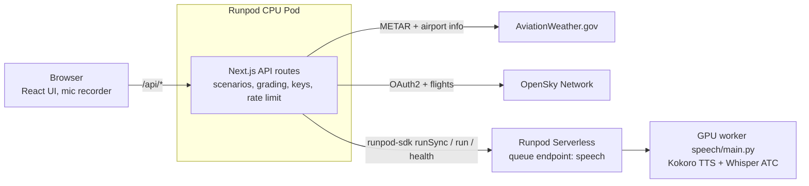

# Architecture



| Component | Runs on | Does | Talks to |
|---|---|---|---|
| UI (`web/app/page.tsx`, `web/app/components/`) | Browser | Pick airport and call type, play audio, record the mic, show the scorecard | `/api/*` only |
| API routes (`web/app/api/*`) | Runpod CPU Pod, `next start` | Build scenarios, grade, rate-limit, hold keys | AWC, OpenSky, speech worker |
| Speech worker (`speech/main.py`) | Runpod Serverless GPU, queue endpoint | `tts`, `transcribe`, `ping` | Nothing external |

The browser can't call the Serverless endpoint directly, because every request needs a bearer key. The Pod serves a public HTTPS URL and keeps the key on the server.

A queue endpoint holds a job while a worker cold-starts. A load-balancing endpoint would return errors until a worker is ready, and every client would need its own retry loop.

## Flow A: new call

1. The browser sends `POST /api/scenario {airport, type}`.
2. The route fetches three things in parallel: the METAR and airport info from AWC, and a GA flight from OpenSky for the previous UTC day. Approach calls use an arrival; the other call types use a departure.
3. Each source returns its data with a provenance (`live`, `cached`, `opensky` or `synthetic`) and any warnings.
4. `buildScenario()` picks the runway from the wind and fills the call type's template. It returns the controller text, the words for TTS and the answer key (`expected`). The same seed and data always give the same scenario.
5. The UI shows the call card at once, with the text hidden by default, and the warnings as banners.

A call type whose `airports.json` fields are `TODO` returns 422 and names the missing fields. Today only `approaches` is `TODO`, so only `approach_clearance` returns 422.

## Flow B: hear it

1. The UI sends `POST /api/speak {text}` in parallel with showing the card. The text never waits for the GPU.
2. The route calls `synthesize()` in `lib/runpod.ts`, which runs a `tts` job with `runSync`.
3. The worker renders the text with Kokoro, applies a radio filter (300–3,000 Hz band, hiss, soft clipping) and returns a 24 kHz WAV as base64.
4. If the job is still queued at 80 s, the route returns 503 `speech_warming`. The UI retries twice, 3 s apart, and then switches to text-only. The queued job keeps waking the worker meanwhile.

## Flow C: read back

1. The user holds the talk button (or Space while it has focus). The browser records with `MediaRecorder` and converts the audio to a 16 kHz mono 16-bit WAV, at most 30 s.
2. The UI sends `POST /api/attempt {scenario, audio_wav_b64}`.
3. The route checks the WAV header on the Pod first (16 kHz, mono, 16-bit, 0.5–30 s), so a bad file never reaches the GPU.
4. `transcribe()` runs a `transcribe` job. Whisper, fine-tuned on ATC speech, returns the transcript.
5. `grade()` runs on the CPU. It normalizes the transcript and matches each expected item (callsign, altitude, heading, frequency, squawk, runway, ...) as correct, incorrect or missing.
6. The response holds the transcript and the grade.

When voice is unavailable (mic blocked, worker failed, warm-up retries used up), the user types the readback and the UI calls `POST /api/grade {scenario, transcript}`. Grading is the same.

## Flow D: warm-up

1. On page load the UI sends `POST /api/warmup`.
2. `warmUp()` submits a `ping` job with `run` (no waiting) and returns `endpoint.health()`.
3. The `ping` job loads both models, so the first real `tts` job finds a warm worker.
4. The UI polls every 10 s and colors the GPU status dot. Polling stops once a worker is ready (`ready`, `idle` or `running` > 0) or the endpoint is offline. Only `running` means a billed worker.

## Timeouts and caches

| What | Value |
|---|---|
| Upstream fetch (AWC, OpenSky) | 6 s, retried twice on 429/5xx/timeout; `Retry-After` honored up to 5 s |
| `runSync` from the Pod | 80 s, below the proxy's 100 s limit |
| Worker job | 60 s (`execution_timeout_ms`) |
| Worker idle before scale-down | 300 s |
| METAR cache | fresh 5 min, usable 3 h |
| Airport info cache | 24 h |
| OpenSky flights cache | 6 h per airport, direction and date |

Caches and the rate limiter are module-level `Map`s in one Pod process. Every user shares them, and a restart empties them.

## Error responses

Every route returns `{error: {code, message, source}}` on failure.

| Status | Code | When |
|---|---|---|
| 413 | `payload_too_large` | Body over 1.6 MB |
| 422 | `invalid_input` | zod validation failed, a bad WAV, or `TODO` airport fields |
| 429 | `rate_limited` | Per-IP limit |
| 500 | `internal` | Our own bug or a missing AWC/OpenSky env var |
| 502 | `speech_failed` | Worker job failed, or the worker is unreachable |
| 502 | `upstream_failed` | An upstream failed with no fallback |
| 503 | `speech_warming` | `runSync` reached 80 s while the job was queued |

Server logs hold route, status, latency, cache hit and fallback flags only. Audio and transcripts are never stored or logged.

## Hosting options

### Built: everything on Runpod

The whole Next.js app (UI and API routes) runs on one Runpod CPU Pod, and the speech models run on a Runpod Serverless GPU endpoint. We chose this because the sample shows two Runpod products working together: an always-on CPU Pod for the web app and a scale-to-zero GPU endpoint for inference. Every key lives in the Pod's environment, and the browser talks to one origin.

### Option, not built: UI on Vercel, API on Runpod

Deploy the same Next.js app twice. Vercel serves the pages and rewrites `/api/*` to the Pod, so the browser still sees one origin and Vercel holds no secrets:

```ts
// web/next.config.ts — the only code change
const nextConfig: NextConfig = {
  async rewrites() {
    const api = process.env.API_ORIGIN; // e.g. https://<POD_ID>-3000.proxy.runpod.net; unset on the Pod
    return api ? [{ source: "/api/:path*", destination: `${api}/api/:path*` }] : [];
  },
};
```

What it buys: the page stays up when the Pod is stopped or not deployed, so users see the app and a clear "backend offline" state instead of a dead URL.

What it costs:
- Behind the rewrite, the Pod sees Vercel's IP in `cf-connecting-ip`, so `lib/rateLimit.ts` would put every user in one bucket. Key on the first `x-forwarded-for` entry instead. A caller who hits the Pod directly can forge that header; GPU spend stays capped by `workers=(0, 1)`.
- Two deploys to keep in sync, and the UI still needs the Pod for every call, warm-up, and grade.

For this sample, that trade isn't worth it. Pick it if you need the UI online while the backend is off.
